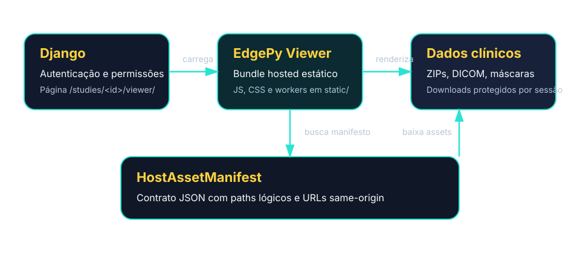
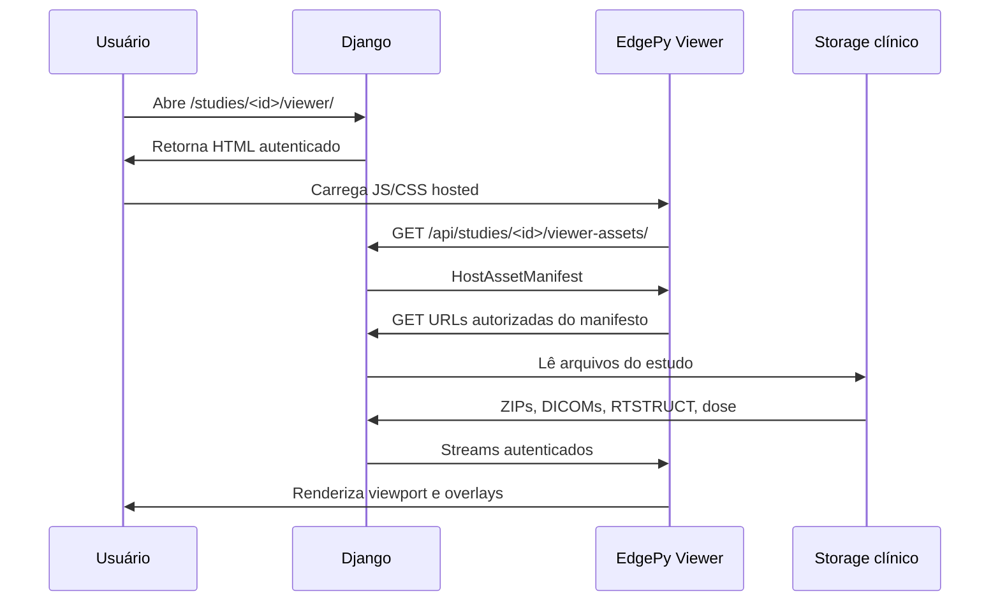
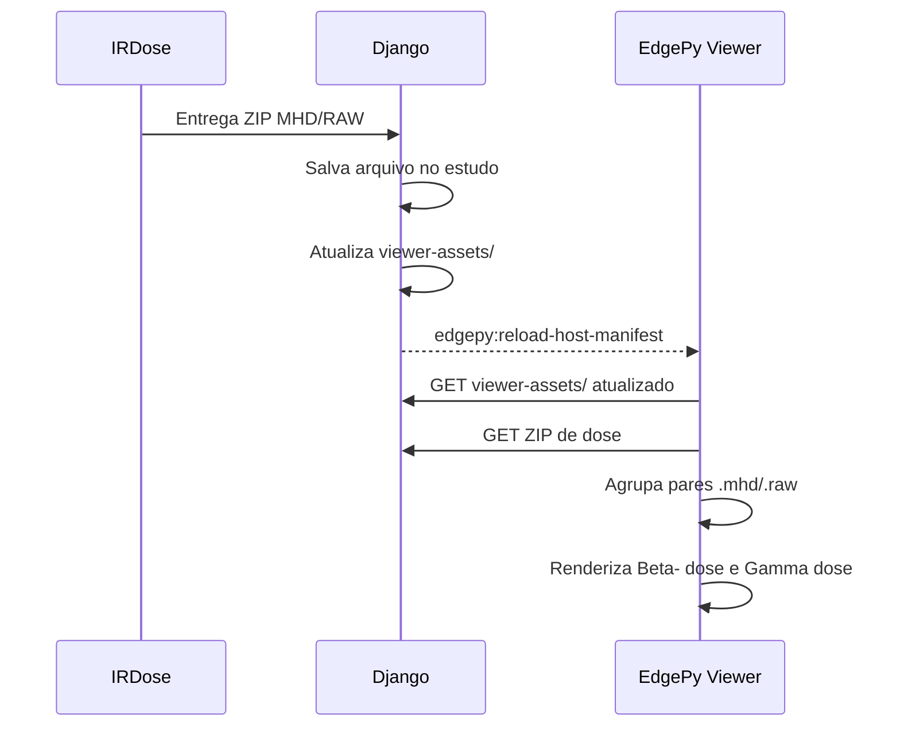

# How-to: Integrar o EdgePy Viewer com um app Django

Utilize este guia caso deseje integrar o **EdgePy Viewer** em uma aplicação Django que necessite de visualização de imagens médicas, RTSTRUCT e mapas de dose. O EdgePy Viewer é um pacote JS/CSS estático que roda no navegador e baixa somente os assets autorizados pelo host.

<section class="edgepy-hero-card" markdown>
**Objetivo da integração:** Django continua responsável por autenticação, autorização, persistência e entrega dos arquivos clínicos. O EdgePy Viewer é servido como JS/CSS estático, roda no navegador e baixa somente os assets autorizados pelo host.
</section>

## Resultado esperado

Ao final da integração, o app Django terá:

- uma página autenticada que renderiza o viewer em `/studies/<id>/viewer/`;
- o pacote hosted em `static/clinical-viewer/`;
- um endpoint `viewer-assets/` que retorna `HostAssetManifest`;
- endpoints autenticados para baixar ZIPs, DICOMs, RTSTRUCT, máscaras e dose;
- um fluxo pós-simulação que publica ZIPs MHD/RAW como overlays de dose;
- botão `Sair` no rail lateral usando `ui.exitUrl`;
- painel `Agents` para executar agentes Python locais sob demanda;
- debug oculto por padrão e habilitado somente com `?debug=1`.

## Visão da arquitetura

O caminho principal e recomendado é **same-origin**. Não use iframe ou `postMessage` cross-origin como integração oficial, a menos que seja um fluxo experimental separado.

## Fluxo de runtime





## Step-by-step de integração

**1. Baixar e instalar o pacote hosted**

Gere os assets a partir do código-fonte conforme a página [Obter e construir](../downloads.md). Copie a pasta `clinical-viewer/` produzida para um diretório de arquivos estáticos do seu projeto Django.

**2. Criar página do viewer**

Renderize um template autenticado, defina `window.PYCOM_VIEWER_CONFIG` e `window.PYCOM_CLINICAL_VIEWER_CONFIG`, e só depois carregue o JS hosted.

**3. Implementar manifesto**

Retorne `HostAssetManifest` com `path` lógico e `url` autenticada para cada asset clínico.

**4. Servir arquivos**

Use `FileResponse`, sessão Django e checagem de permissão por estudo e por arquivo.

**5. Publicar dose**

Após simulação, salve o ZIP MHD/RAW e recarregue o manifesto.

**6. Validar no browser**

Confira Network, viewport, overlays, segurança e dose beta/gamma.

## 1. Instale os assets hosted

Para apps Django, gere o build hosted no ambiente de desenvolvimento ou CI. O servidor Django de produção **não precisa de Node.js**: ele apenas serve JS/CSS estáticos e arquivos clínicos autenticados.

Se você empacotou o diretório conforme a página [Obter e construir](../downloads.md), terá o arquivo:

```text
edgepy-viewer-hosted-0.2.0.zip
```

Antes de instalar, confira a estrutura do ZIP:

```bash
unzip -l edgepy-viewer-hosted-0.2.0.zip
```

O ZIP deve conter a pasta `clinical-viewer/` na raiz:

```text
clinical-viewer/
  edgepy-viewer-hosted.iife.js
  edgepy-viewer-hosted.css
  assets/
    *.js
  agents/
    manifest.json
    pycom_agent.py
    viewer_context_summary.py
    dose_statistics.py
```

Instale o pacote em um diretório de arquivos estáticos versionado pelo seu app Django, por exemplo `static/` na raiz do projeto:

```bash
mkdir -p static
unzip edgepy-viewer-hosted-0.2.0.zip -d static
```

Depois da descompactação, estes caminhos devem existir no seu projeto:

```text
static/clinical-viewer/
  edgepy-viewer-hosted.iife.js
  edgepy-viewer-hosted.css
  assets/
  agents/
```

Se o seu projeto usa `STATICFILES_DIRS`, inclua esse diretório de origem em `settings.py`:

```python
from pathlib import Path

BASE_DIR = Path(__file__).resolve().parent.parent

STATIC_URL = "static/"
STATICFILES_DIRS = [BASE_DIR / "static"]
```

Em produção, rode o fluxo normal do seu projeto para copiar os arquivos para `STATIC_ROOT`:

```bash
python manage.py collectstatic
```

Confirme no navegador ou com `curl` que o Django resolve estes assets:

```text
/static/clinical-viewer/edgepy-viewer-hosted.css
/static/clinical-viewer/edgepy-viewer-hosted.iife.js
```

!!! warning "Não descompacte dentro de `static/clinical-viewer/`"
    O ZIP já inclui a pasta `clinical-viewer/`. Se você fizer `unzip ... -d static/clinical-viewer`, os arquivos ficarão em `static/clinical-viewer/clinical-viewer/` e `` retornará `404`.


## 2. Crie a página Django do viewer

Template recomendado:

```html

<!doctype html>
<html lang="pt-BR">
  <head>
    <meta charset="utf-8" />
    <meta name="viewport" content="width=device-width, initial-scale=1" />
    <title>EdgePy Viewer | {{ study.patient_name }}</title>
    <link
      rel="stylesheet"
      href="?v=EDGEpy_VERSION"
    />
    <style>
      html,
      body {
        height: 100%;
        margin: 0;
        overflow: hidden;
      }

      #pycom-clinical-viewer {
        display: flex;
        flex-direction: column;
        height: 100%;
        min-height: 0;
      }
    </style>
  </head>
  <body>
    <section id="pycom-clinical-viewer" data-pycom-clinical-viewer></section>
    <script>
      const edgepyViewerDebug =
        new URLSearchParams(window.location.search).get("debug") === "1";
      window.PYCOM_CLINICAL_VIEWER_CONFIG = {
        mode: "hosted",
        features: {
          localAgents: true,
        },
        pythonAgents: {
          bundledBaseUrl: "",
        },
        ui: {
          displayMode: "workstation",
          debug: edgepyViewerDebug,
          exitUrl: "",
        },
      };
      window.PYCOM_VIEWER_CONFIG = {
        viewerAssetsUrl: "",
      };
    </script>
    <script src="?v=EDGEpy_VERSION"></script>
  </body>
</html>
```

Contratos importantes:

- `window.PYCOM_VIEWER_CONFIG.viewerAssetsUrl` aponta para o manifesto do estudo.
- `window.PYCOM_CLINICAL_VIEWER_CONFIG.ui.exitUrl` mostra a ação `Sair` no rodapé do rail lateral.
- `window.PYCOM_CLINICAL_VIEWER_CONFIG.pythonAgents.bundledBaseUrl` aponta para os agentes Python empacotados no static root.
- o painel `Agents` aparece por padrão; use `features.localAgents: false` para ocultá-lo.
- `?debug=1` habilita o botão/painel de debug; em uso normal, o debug fica oculto.
- `data-pycom-clinical-viewer` é o elemento de montagem do viewer.
- O mount precisa ter altura real e `display: flex`.

### Painel Agents

O painel `Agents` é uma opção clicável no rail lateral e abre o `PyScript Lab`. A aba `Editor` permite editar e executar Python sobre o slice ativo; a aba `Agents` carrega módulos empacotados e confirma cada execução em `Run agent`. Abrir o painel não executa código automaticamente.

O pacote inclui dois agentes de referência:

- `Viewer Context Summary`: resume scan, série, slice e layers ativos no viewer;
- `Dose Statistics`: prioriza o overlay de dose visível, resolve os mesmos assets usados pelo renderer e calcula estatísticas básicas do volume MHD/RAW diretamente no navegador.

O runtime é criado pelo `PyWorker` oficial do PyScript. O Pyodide atua como engine CPython/WebAssembly dentro desse worker. Pixels do slice ativo e voxels de dose são transferidos como `Float32Array`, sem serialização do conteúdo binário em JSON.

O editor inclui exemplos de resumo da imagem, máscara por threshold e estatísticas de dose. Máscaras retornadas pelo Python aparecem como overlay 2D temporário vinculado ao slice analisado. Consulte [Como usar o editor PyScript](usar-pyscript.md) para conhecer o contrato completo.

Por padrão, o PyScript carrega o interpretador Pyodide fixado pelo jsDelivr e cria um worker `blob:`. Portanto, a política CSP do host precisa permitir esses recursos, ou o interpretador deverá ser publicado em origem aprovada antes de uma implantação com CSP restritiva.

## 3. Defina as rotas Django

Use nomes finais compatíveis com o app real. Um formato simples é:

```python
from django.urls import path
from . import views

urlpatterns = [
    path("studies/<int:study_id>/viewer/", views.study_viewer, name="study-viewer"),
    path("api/studies/<int:study_id>/viewer-assets/", views.viewer_assets, name="viewer-assets"),
    path("api/studies/<int:study_id>/archives/<int:archive_id>/download/", views.download_archive, name="download-archive"),
]
```

## 4. Retorne o HostAssetManifest

O manifesto descreve os arquivos que o viewer pode baixar. Use paths lógicos, nunca paths do filesystem.

```python
from django.contrib.auth.decorators import login_required
from django.http import JsonResponse
from django.shortcuts import get_object_or_404, render
from django.urls import reverse

@login_required
def study_viewer(request, study_id):
    study = get_object_or_404(DosimetryStudy, pk=study_id)
    assert_user_can_access(request.user, study)
    return render(request, "viewer/study_viewer.html", {"study": study})

@login_required
def viewer_assets(request, study_id):
    study = get_object_or_404(DosimetryStudy, pk=study_id)
    assert_user_can_access(request.user, study)

    assets = []
    for archive in study.archives.all():
        assets.append({
            "path": logical_path_for_archive(archive),
            "url": reverse("download-archive", args=[study.pk, archive.pk]),
            "kind": archive.viewer_kind,
            "contentType": archive.content_type,
            "size": archive.file.size,
        })

    return JsonResponse({
        "studyUid": f"irdose-study-{study.pk}",
        "label": str(study),
        "assets": assets,
    })
```

Exemplo de resposta:

```json
{
  "studyUid": "irdose-study-42",
  "label": "Paciente exemplo",
  "assets": [
    {
      "path": "acquisitions/scan1/ct/ct.zip",
      "url": "/api/studies/42/archives/10/download/",
      "kind": "archive",
      "contentType": "application/zip",
      "size": 31572947
    },
    {
      "path": "acquisitions/scan1/spect/spect.zip",
      "url": "/api/studies/42/archives/11/download/",
      "kind": "archive",
      "contentType": "application/zip"
    },
    {
      "path": "targets/rtstruct/liver.zip",
      "url": "/api/studies/42/archives/12/download/",
      "kind": "archive",
      "contentType": "application/zip"
    }
  ]
}
```

Regras do manifesto:

- `path` é lógico e relativo.
- `url` deve ser same-origin autenticada ou URL assinada de curta duração.
- use `kind: "archive"` para ZIPs de CT/SPECT/PET/máscaras/RTSTRUCT;
- use `kind: "dose"` para ZIPs de dose MHD/RAW;
- não envie milhares de DICOMs individualmente quando já há ZIPs de aquisição;
- não use Base64 para DICOM, ZIP, máscara ou dose.

## 5. Sirva os arquivos clínicos com permissão

Exemplo de download autenticado:

```python
from django.contrib.auth.decorators import login_required
from django.http import FileResponse, Http404
from django.shortcuts import get_object_or_404

@login_required
def download_archive(request, study_id, archive_id):
    study = get_object_or_404(DosimetryStudy, pk=study_id)
    assert_user_can_access(request.user, study)
    archive = get_object_or_404(study.archives, pk=archive_id)

    if not archive.file:
        raise Http404("Archive not found")

    response = FileResponse(archive.file.open("rb"), content_type="application/zip")
    response["Content-Disposition"] = f'attachment; filename="{archive.file.name.rsplit("/", 1)[-1]}"'
    response["X-Content-Type-Options"] = "nosniff"
    return response
```

## 6. Publique dose MHD/RAW pós-simulação

Quando a aplicação terminar a simulação, salve o ZIP de dose no estudo e faça o manifesto incluir um asset `kind: "dose"`.

```json
{
  "path": "dose/lu177/synthetic-dose-maps.zip",
  "url": "/api/studies/42/archives/88/download/",
  "kind": "dose",
  "contentType": "application/zip",
  "metadata": {
    "role": "dose",
    "label": "Lu-177 dose maps"
  }
}
```

Formato esperado dentro do ZIP:

```text
patient_beta--Dose.mhd
patient_beta--Dose.raw
patient_gamma-Dose.mhd
patient_gamma-Dose.raw
```

O `.mhd` deve apontar para o RAW correspondente:

```text
ObjectType = Image
NDims = 3
DimSize = 256 256 199
ElementSpacing = 1.95313 1.95313 1.95313
Offset = -249.023 -410.023 1156.93
ElementType = MET_FLOAT
ElementDataFile = patient_beta--Dose.raw
```

Fluxo pós-simulação:



Disparo no browser:

```js
window.dispatchEvent(
  new CustomEvent("edgepy:reload-host-manifest", {
    detail: { manifestUrl: "/api/studies/42/viewer-assets/" },
  }),
);
```

Se `manifestUrl` for omitido, o viewer reutiliza `window.PYCOM_VIEWER_CONFIG.viewerAssetsUrl`.

Labels esperados para o pacote validado:

```text
patient_beta--Dose.mhd/.raw  -> Beta- dose
patient_gamma-Dose.mhd/.raw  -> Gamma dose
```

## 7. Valide a integração

No backend Django:

```bash
python manage.py check
python manage.py test
python manage.py runserver
```

No navegador:

1. Faça login no Django.
2. Abra `/studies/<id>/viewer/`.
3. Confirme que `edgepy-viewer-hosted.css` e `edgepy-viewer-hosted.iife.js` retornam `200`.
4. Confirme que `viewer-assets/` retorna `200` e JSON válido.
5. Confirme que cada `url` do manifesto retorna `200` para usuário autorizado.
6. Confirme que as mesmas URLs retornam login, `403` ou `404` para usuário não autorizado.
7. Confirme que CT/SPECT/PET renderizam.
8. Confirme que RTSTRUCT/máscaras aparecem em `Overlays`.
9. Confirme que o botão `Sair` no rail volta para a página definida em `exitUrl`.
10. Publique manualmente ou gere por simulação o ZIP de dose.
11. Confirme que `viewer-assets/` atualizado inclui `kind: "dose"`.
12. Dispare `edgepy:reload-host-manifest`.
13. Confirme que `Beta- dose` e `Gamma dose` aparecem no painel `Overlays`.
14. Confirme visualmente o alinhamento da dose com a CT de referência.

## Checklist de segurança

- Exigir login na página do viewer.
- Exigir login no endpoint `viewer-assets/`.
- Exigir login nos downloads.
- Verificar que o usuário pode acessar o estudo.
- Verificar que cada arquivo pertence ao estudo solicitado.
- Rejeitar paths lógicos absolutos, com `..` ou segmentos vazios.
- Não retornar paths absolutos do servidor.
- Retornar `X-Content-Type-Options: nosniff` em respostas de arquivo.
- Preferir sessão same-origin.

## Solução de problemas

Se o viewer aparece, mas a imagem não renderiza:

- verifique no Network se `clinical-viewer/assets/*.js` retorna `200`;
- verifique se o mount tem altura real e `display: flex`;
- confirme que `viewer-assets/` retorna `kind: "archive"` para ZIPs;
- confirme que os ZIPs contêm DICOMs válidos;
- abra o Console e procure mensagens do Cornerstone ou dos workers.

Se o manifest retorna `302` para login, a sessão Django não está autenticada no navegador atual.

Se o mapa de dose não aparece como camada:

- confirme que o asset está no manifesto com `kind: "dose"`;
- confirme que o path lógico contém `dose/` ou um nome com `-dose` quando o ZIP é expandido internamente;
- confirme que o ZIP contém pares `.mhd` e `.raw` com o mesmo nome base;
- confirme que o `.mhd` usa `ElementType = MET_FLOAT` e aponta `ElementDataFile` para o `.raw` correto;
- confirme que `Offset`, `ElementSpacing` e `DimSize` são compatíveis com a CT usada como referência.

Se a interface ainda carrega uma versão antiga do viewer:

- confirme que o template referencia `edgepy-viewer-hosted.iife.js` e `edgepy-viewer-hosted.css`;
- use cache-bust nos assets estáticos durante validações, por exemplo `?v=20260626-rail-exit-status`;
- faça hard reload do navegador e verifique no Network se o JS/CSS novo retornou `200`.
