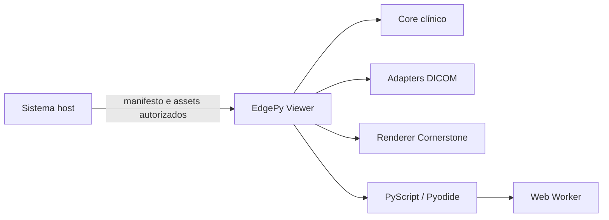

# EdgePy Viewer

Documentação pública do EdgePy Viewer, uma plataforma web para visualização clínica e processamento Python em borda sobre estudos DICOM, SPECT/PET, CT, máscaras, RTSTRUCT e mapas de dose MHD/RAW.

<section class="edgepy-hero-card" markdown>

**EdgePy Viewer** foi desenhado para ser hospedado pelo sistema clínico ou de pesquisa que já controla autenticação, permissões e armazenamento. O viewer baixa somente os assets autorizados pelo host, monta CT/SPECT/PET e adiciona overlays de estruturas ou dose diretamente no navegador.

</section>

O software foi criado no contexto do Mestrado Profissional em Tecnologia das Radiações em Ciências da Saúde do IPEN por Guilherme Policicio Rey, sob orientação do Prof. Dr. Orlando Rodrigues Junior.

Esta publicação contém somente código, documentação e exemplos sintéticos. Dados clínicos, mídia derivada de pacientes e artefatos institucionais restritos não fazem parte do repositório público.

## O que o viewer faz

- Importa séries DICOM locais ou fornecidas por um host web.
- Renderiza pilhas CT e imagens funcionais usando Cornerstone.
- Sobrepõe máscaras e contornos RTSTRUCT quando há geometria compatível.
- Sobrepõe mapas de dose MHD/RAW pós-simulação como camadas selecionáveis.
- Executa agentes e scripts Python localmente com PyScript/Pyodide.
- Expõe build hosted para integração com aplicações Django.
- Mantém os dados de imagem no navegador durante o processamento local.

## Arquitetura resumida

O host continua responsável por autenticação, autorização, persistência e entrega dos arquivos. O viewer atua como camada de visualização e processamento local.

## Público-alvo

- Pesquisadores que revisam estudos SPECT/CT, PET/CT, VOIs e resultados de dosimetria.
- Desenvolvedores que integram visualização DICOM em sistemas web existentes.
- Equipes que exploram processamento em borda com Python no navegador.

## Próximos passos

- [Obter e construir o software](downloads.md).
- [Integrar com uma aplicação Django](how-to/integrar-django.md).
- [Usar o editor PyScript](how-to/usar-pyscript.md).
- [Consultar o código-fonte](https://github.com/guilhermeRey/ipen-edgepy-viewer).

!!! warning "Uso clínico"
    Esta é uma versão preliminar de pesquisa. Resultados visuais, máscaras, estatísticas e scripts exigem validação humana e não devem ser usados automaticamente para diagnóstico ou decisão clínica.
